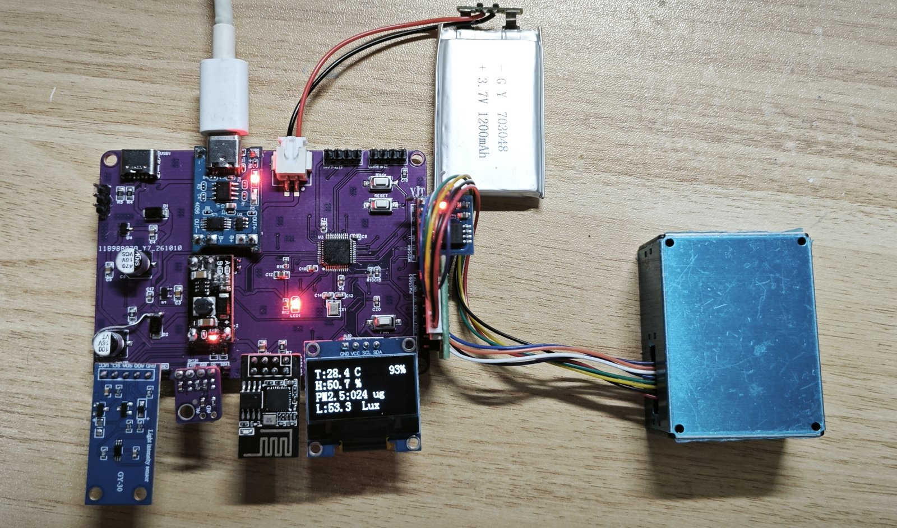
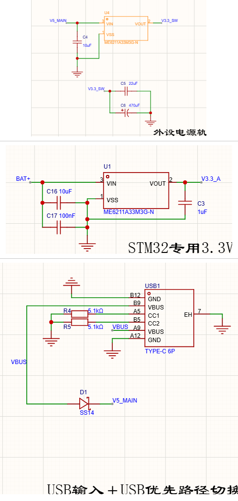
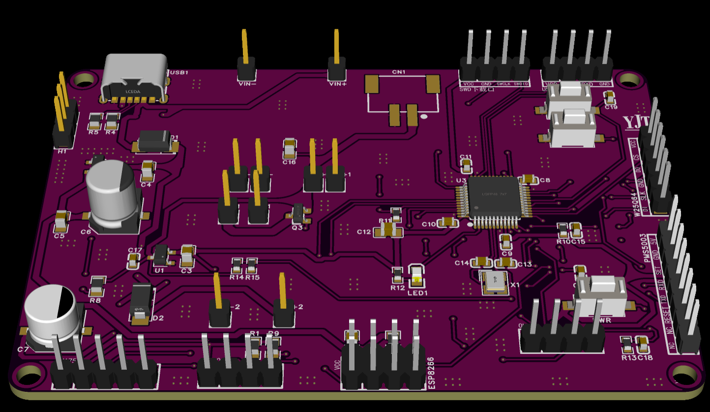
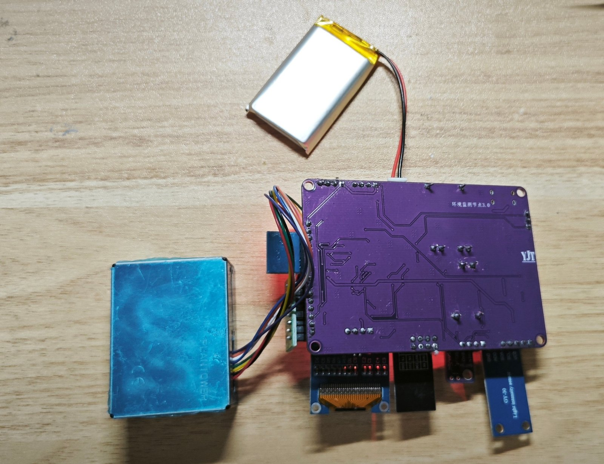
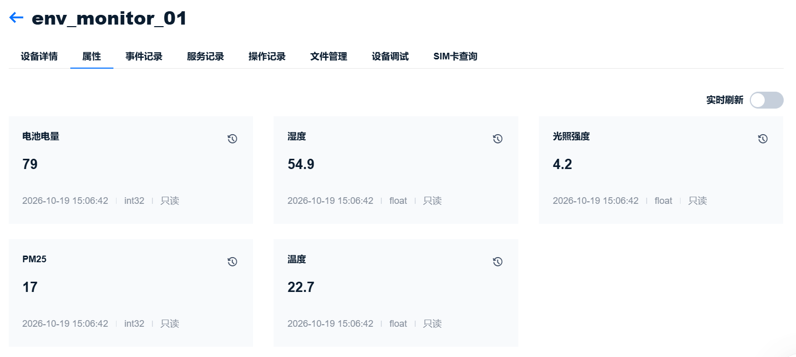
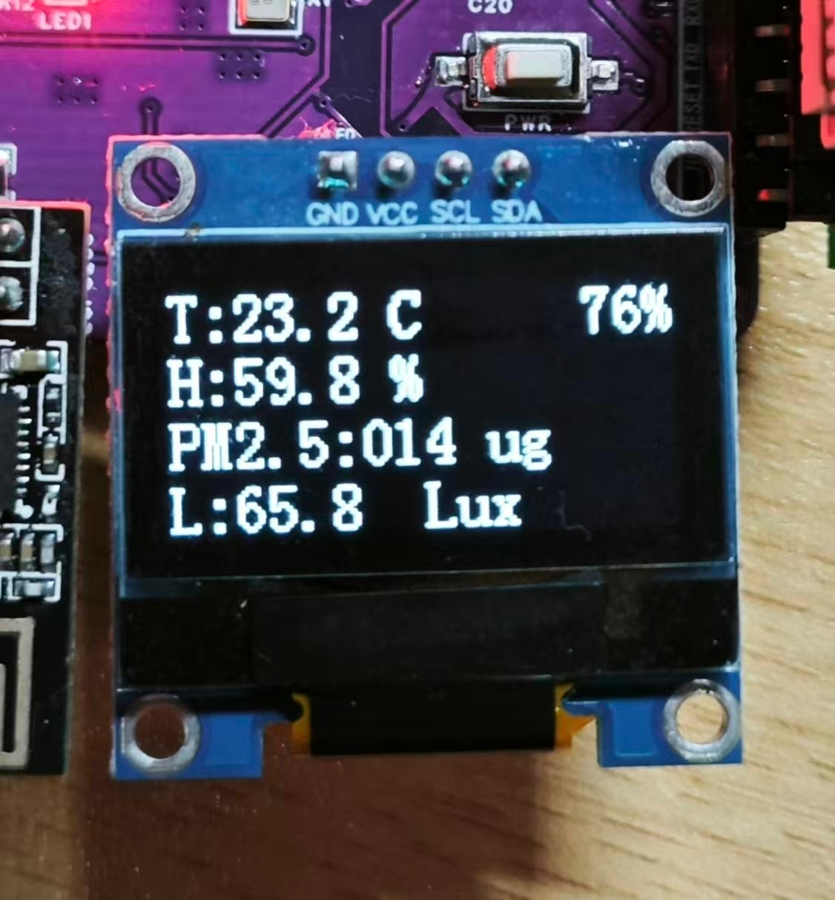
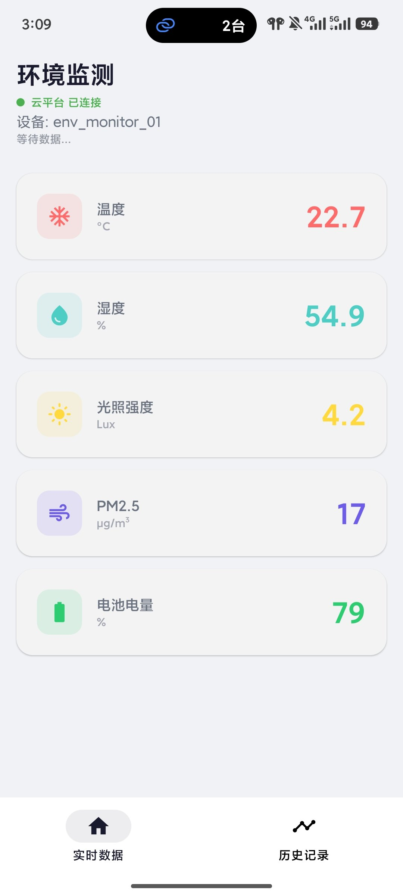
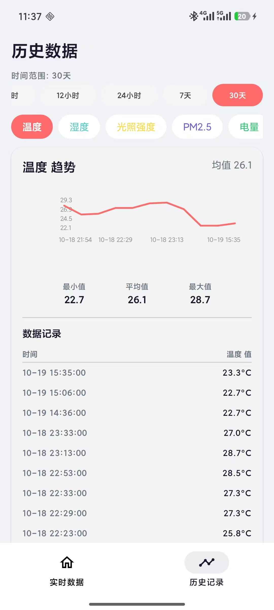
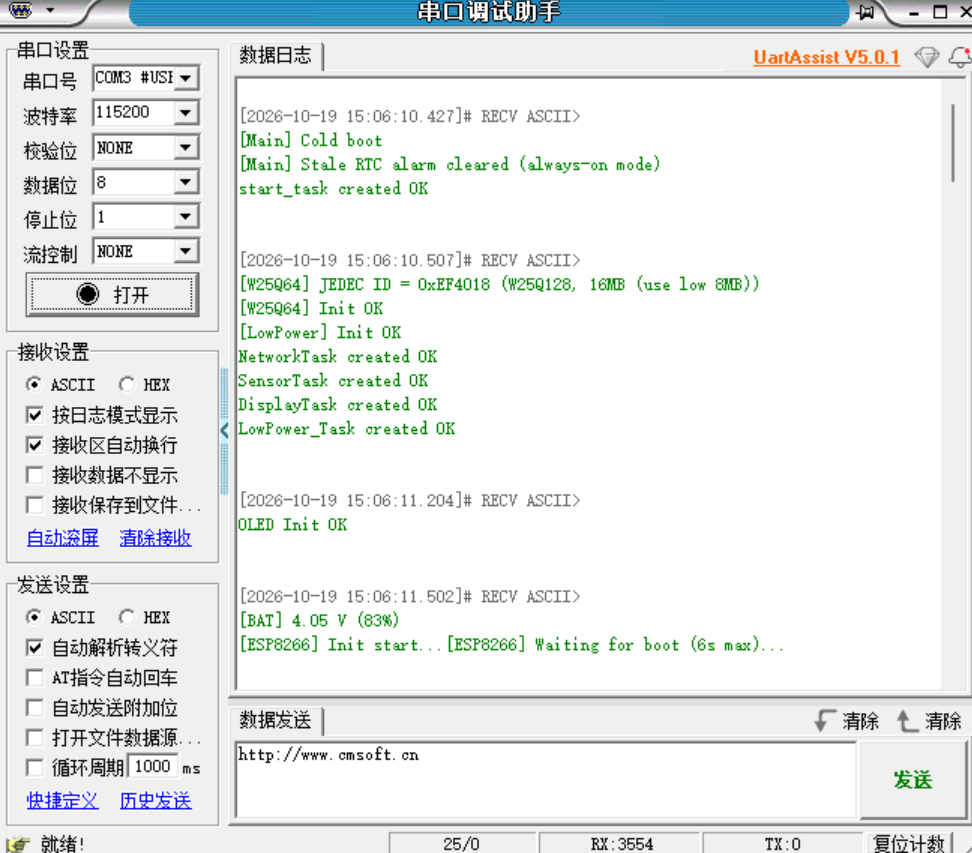
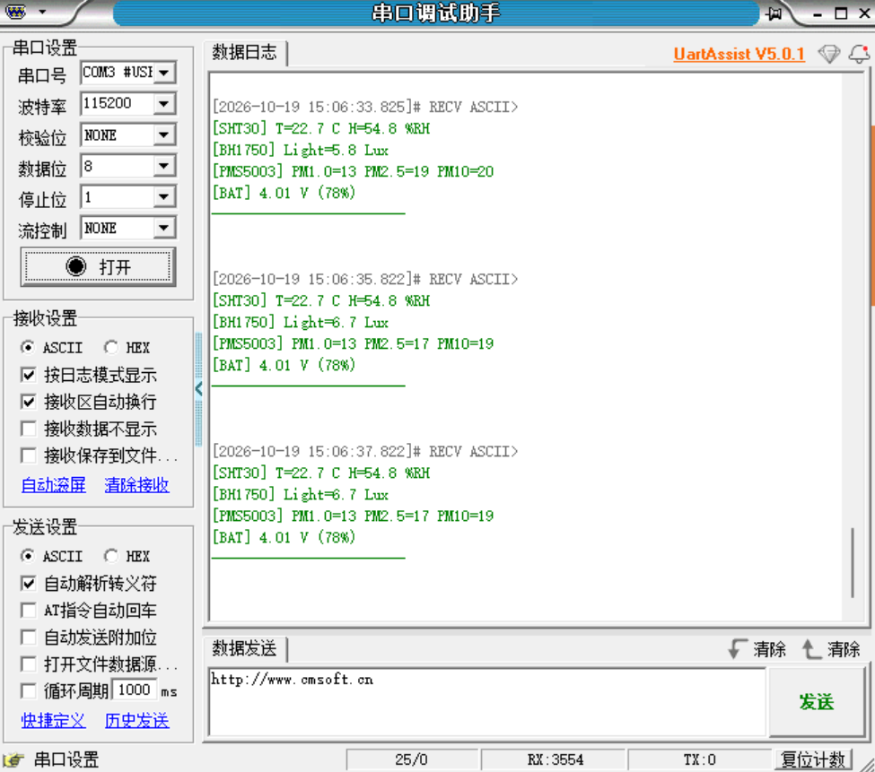

# 环境监测节点 3.0 · 低功耗物联网监测终端

> **一台能自己醒来、自己上报、自己省电的环境监测设备。**
> STM32F103 + FreeRTOS ｜ 多传感器采集 ｜ ESP8266 + 手写 MQTT 上云 ｜ Android App 远程查看
> **实测待机 300 µA，1200 mAh 电池纯待机约 5.5 个月**



---

## 📌 核心数据

| 项目 | 指标 |
|---|---|
| **主控** | STM32F103C8T6（Cortex-M3 @ 72 MHz） |
| **传感器** | SHT30（温湿度）· BH1750（光照）· PMS5003（PM1.0 / 2.5 / 10） |
| **本地存储** | W25Q128（16 MB SPI Flash） |
| **通信** | ESP8266 + **手写 MQTT 协议**（不依赖 IoT SDK） |
| **云平台** | 中国移动 OneNET |
| **移动端** | Android（Kotlin + Jetpack Compose + Room） |
| **供电** | 锂电池 1200 mAh + TP4056 充电 + MT3608 升压 + ME6211×2 |
| **PCB** | 85 × 60 mm，2 层，1.6 mm，沉金 |
| **待机电流** | **300 µA（万用表实测）** |
| **纯待机续航** | **约 5.5 个月** |
| **周期上报续航** | 约 20 天（30 分钟一次） |

---

## 📖 项目简介

这是一个**电池供电、可长期无人值守**的环境监测终端：

- 每 30 分钟自动唤醒，采集**温度、湿度、光照、PM1.0/2.5/10 和电池电量**
- 通过 WiFi 以 MQTT 协议上报到 OneNET 云平台
- 配套 Android App 可查看实时数据与最长 30 天的历史曲线
- **OLED 本地显示**，不联网也能看当前数据
- **断网不丢数据**：先存本地 Flash，联网后自动补传
- 三种工作姿态：**常亮 / 周期唤醒 / 关机**

**设计上的三个关键点：**

| # | 设计 | 解决的问题 |
|---|---|---|
| **1** | **双轨电源架构** —— MCU 走电池直供的常开轨，外设走受控的门控轨 | 升压模块的 mA 级静态电流是续航杀手，但不关它省不了电；而 MCU 不能被一起断电 |
| **2** | **只门控真正费电的外设** | 为了 25 µA 去门控低功耗传感器，会引入跨域信号倒灌，需要 13 个钳位二极管；把低功耗外设放常开轨，架构上直接消除问题 |
| **3** | **App 回补式同步** | App 关闭期间设备仍在上报，但手机本地不会记录；打开 App 时按时间区间从云端补齐最多 7 天 |

---

## 🧩 硬件设计

### 硬件清单

| 模块 | 型号 | 接口 | 说明 |
|---|---|---|---|
| 主控 | STM32F103C8T6 | — | Cortex-M3 @72MHz，LQFP-48 |
| 温湿度 | SHT30 | I2C1（PB6/PB7） | ±0.3 ℃ / ±2 %RH，带 CRC-8 校验 |
| 光照 | BH1750 | I2C1（PB6/PB7） | 1~65535 Lux，与 SHT30 共总线 |
| PM2.5 | 攀藤 PMS5003 | USART3（PB10/PB11） | 激光式，需 5V，**PB13 控制复位** |
| 显示 | 0.96" OLED 128×64 | 软件 I2C（PB8/PB9） | SSD1306 |
| WiFi | ESP8266 ESP-01S | USART2（PA2/PA3） | AT 固件 |
| 存储 | W25Q64 / W25Q128 | SPI1（PA4~PA7） | 离线帧缓存，代码兼容两种 JEDEC ID |
| **电池检测** | 电阻分压 R14/R15 | **ADC1_IN1（PA1）** | 电量百分比 |
| **升压门控** | AO3401A（P-MOSFET） | **PB12 + R8 100k 上拉** | 睡眠时切断整条升压链 |
| 充电 | TP4056 模块 | — | 锂电池充电管理 |
| 升压 | MT3608 模块 | — | 3.7 V → 5 V（受 Q3 门控） |
| 稳压 | ME6211A33M3G-N ×2 | — | U1 供 MCU 常开轨，U4 供 ESP8266 门控轨 |
| 电池 | 703048 / 1200 mAh | — | 3.7 V 锂聚合物 |

### 电源树（核心设计）

```
                     ┌─ BAT+ (3.0~4.2V) ──────────────────────────────┐
                     │                                                 │
        ┌────────────┴─────────────┐                 ┌─────────────────┴────────────┐
        │  U1: ME6211A33M3G-N      │                 │  Q3: AO3401A (P-MOSFET)      │
        │  BAT+ → V3.3_A           │                 │  栅极 = PB12（R8 100k 上拉） │
        └────────────┬─────────────┘                 └─────────────────┬────────────┘
                     │                                                 │
              【V3.3_A 常开轨】                                  【BOOST_IN】
                     │                                                 │
   ┌─────────┬───────┴────────┬──────────┐                    ┌────────┴─────────┐
   │  STM32  │  SHT30        │ BH1750   │                    │ MT3608 升压模块   │
   │         │  W25Q128      │ OLED     │                    │  → 5V            │
   └─────────┴───────────────┴──────────┘                    └────────┬─────────┘
                                                                      │
                                                            【V5_MAIN ≈ 5V】
                                                              ┌───────┴────────┐
                                                              │                │
                                                     【V5_PMS】        ┌───────┴────────┐
                                                              │        │ U4: ME6211     │
                                                        PMS5003        │ 5V → V3.3_SW   │
                                                                       └───────┬────────┘
                                                                               │
                                                                        【V3.3_SW】
                                                                               │
                                                                          ESP8266
```

**辅助路径**：USB 5V → `D1(SS14)` → `V5_MAIN`（USB 供电时也能带起门控侧）

**三个要点：**

1. **`V3.3_A` 常开** —— MCU 必须一直有电，否则 STANDBY 之后没人能被 RTC 闹钟唤醒。
2. **`Q3` 门控 `BOOST_IN`** —— 睡眠时把整条升压链（含 ESP8266）断电，省掉升压模块的静态电流。
3. **P-MOSFET 源漏方向不能接反** —— 源极接电源侧、漏极接负载侧；反了体二极管就成了永久导通路径，栅极完全失去控制作用。



### 引脚分配

| STM32 引脚 | 连接 | 功能 |
|---|---|---|
| **PA0** | PWR 按键 | WKUP 硬件唤醒 |
| **PA1** | 电池分压中点 | ADC1_IN1，电量检测 |
| PA2 / PA3 | ESP8266 RX / TX | USART2（115200） |
| PA4~PA7 | W25Q CS / SCK / MISO / MOSI | SPI1 |
| PA9 / PA10 | USB-TTL | USART1 调试串口（115200） |
| **PB1** | Mode 按键 | EXTI 双边沿（短按周期 / 长按关机） |
| PB6 / PB7 | SHT30 + BH1750 | I2C1（两传感器共总线，用互斥锁保护） |
| PB8 / PB9 | OLED SCL / SDA | 软件 I2C |
| PB10 / PB11 | PMS5003 RX / TX | USART3（9600） |
| **PB12** | Q3 栅极 | 升压链门控（低=导通） |
| **PB13** | PMS5003 RST | 主动复位（低 ≥1ms） |
| PC13 | LED | 状态指示 |

### PCB

| 参数 | 值 |
|---|---|
| 尺寸 / 层数 | 85 × 60 mm，2 层，1.6 mm，1 oz |
| 大电流走线 | `BAT+`→`Q3`→`BOOST_IN` **1.2 mm**（约 850 mA）；`VBUS`/`V5_MAIN` 0.8 mm |
| 信号线 | 0.254 mm（10 mil） |
| 接地 | 双面铺铜 + **232 个缝合过孔** |





---

## 🏗 软件架构

### FreeRTOS 任务划分

| 任务 | 优先级 | 栈（字） | 周期 / 触发 | 职责 |
|---|---|---|---|---|
| `start_task` | 6 | 200 | 上电一次 | 创建互斥量、初始化 Flash / ADC / 低功耗，建完子任务后自删除 |
| **`LowPower_Task`** | 6 | 128 | 信号量触发 | 收到休眠信号 → 执行关断序列 → STANDBY |
| **`NetworkTask`** | 5 | 384 | 常亮 10 min / 周期一次性 | 低压检查 → ESP8266 初始化 → 连 WiFi → MQTT → 补传 → 上报 |
| **`SensorTask`** | 4 | 320 | 每 2 s | 升压上电 → PMS 复位 → SHT30 / BH1750 / PMS5003 / 电池 |
| **`DisplayTask`** | 2 | 256 | 每 1 s | OLED 刷新（周期模式不点屏） |

**优先级设计理由：** 低功耗最高（用户按键要立刻响应）＞ 网络（关键路径且会被阻塞）＞ 传感器 ＞ 显示（晚 1 秒无人察觉）。

**共享资源用互斥量保护：** `g_I2C_Mutex`（SHT30/BH1750/OLED 共用 I2C）、`g_SPI_Mutex`（Flash）、`s_adc_mutex`（ADC1 单例，防止两个任务抢 EOC 导致死等）。

### 三种工作模式

| 模式 | 进入方式 | 行为 | 续航 |
|---|---|---|---|
| **常亮** | 上电 / 按 PWR | 持续采集 + 显示 + 每 10 分钟上报 | 约 8 小时 |
| **周期** | **短按 Mode（< 3 s）** | STANDBY + **30 分钟 RTC 闹钟**，醒来自动跑一轮再睡 | **约 20 天** |
| **关机** | **长按 Mode（≥ 3 s）** | STANDBY + 无闹钟，仅 PWR 可唤醒 | **约 5.5 个月** |

### 代码结构

```
Core/Src/
├── gpio.c               电源门控初始化（PB12）+ PMS 复位（PB13）
└── stm32f1xx_it.c       EXTI 双边沿按键中断（200ms 消抖 + 长短按判定）

Int/
├── freertos_demo.c      任务创建、常亮/周期双姿态主逻辑、电量上报
├── low_power.c          双模式低功耗、睡前关断序列、STANDBY 中断清场
├── battery.c            寄存器级 ADC 采样 + EMA 滤波 + 电量百分比 + 低压判断
├── sht30.c / bh1750.c   I2C 传感器驱动（BH1750 支持 PowerDown）
├── pms5003.c            USART3 中断收帧 + 帧头同步 + 校验和
├── esp8266.c            AT 指令封装（初始化 / 配网 / TCP / modem sleep）
├── onenet_mqtt.c        手写 MQTT 报文（CONNECT / PUBLISH / PINGREQ）
├── w25q64.c             SPI Flash 缓存（W25Q64/128 双兼容 + 深度掉电）
└── oled.c               软件 I2C OLED 驱动（含 DisplayOff）

AndroidApp/app/src/main/java/com/envmonitor/app/
├── data/mqtt/MqttManager.kt      OneNET HTTP API 查询 + 历史回补
├── data/local/SyncPrefs.kt       记录上次同步时间点
├── data/repository/              去重、批量回补、历史曲线数据
└── ui/dashboard/ + ui/history/   Compose 界面
```

---

## ⚡ 低功耗设计

### 实测数据

```
整机待机电流：300 µA（万用表 µA 档串入电池回路实测）
电池容量：    1200 mAh
纯待机续航：  1200 ÷ 0.3 = 4000 小时 ≈ 167 天 ≈ 5.5 个月
```

**⚠️ 测量注意**：必须断开 USB-TTL 和 ST-Link（调试器会通过 3.3V 引脚反向给板子馈电，读数会从 300 µA 变成 500 µA）。

### 300 µA 的构成

| 来源 | 电流 | 能否进一步降低 |
|---|---|---|
| `U1`（ME6211）静态 | ~30 µA | 换超低 Iq LDO（如 TPS7A02，25 nA） |
| 电池分压 `R14`+`R15` | 21 µA | 换 1 MΩ 电阻 |
| OLED（已关显示） | ~10 µA | 已到位 |
| Flash（深度掉电） | ~1 µA | 已到位 |
| MCU STANDBY | ~3 µA | 已到芯片极限 |
| **PMS5003 残留电压漏电** | **~200 µA** | 需给它的电源轨单独加开关 |

**为什么停在 300 µA：** 在"30 分钟上报一次"的真实场景下，睡眠段只占总耗电约 15%；即使把睡眠电流压到 50 µA，续航也只提升约 12%。真正的瓶颈是"醒着联网的那 20 秒"。

### 睡前关断序列

```c
static void Enter_STANDBY_Mode(uint8_t arm_alarm)
{
    /* ① 关显示 + 光感掉电 + Flash 深度掉电 */
    OLED_Clear();
    OLED_DisplayOff();                  /* 0xAE + 关电荷泵：100~200µA → 10µA */
    vTaskDelay(pdMS_TO_TICKS(20));      /* 等最后几条 I2C 命令发完 */

    BH1750_PowerDown();                 /* 0x00：连续测量 120µA → 0.1µA */
    vTaskDelay(pdMS_TO_TICKS(5));

    W25Q64_PrepareForSleep();           /* 0xB9 深度掉电：10~15µA → 1µA */

    /* ② 跨域引脚拉到安全电平（防 UART 倒灌） */
    HAL_GPIO_WritePin(GPIOA, GPIO_PIN_2, GPIO_PIN_RESET);

    /* ③ 关断整条升压链 */
    HAL_GPIO_WritePin(GPIOB, GPIO_PIN_12, GPIO_PIN_SET);   /* Q3 关断 */

    /* ④ 周期模式设闹钟，关机模式取消 */
    if (arm_alarm) RTC_Set_Alarm_Seconds(LOW_POWER_SLEEP_SECONDS);
    else           HAL_RTC_DeactivateAlarm(&hrtc, RTC_ALARM_A);

    /* ⑤ 中断清场（否则 WFI 会被 pending 中断立即唤醒） */
    PrepareInterruptCleanup();

    /* ⑥ 使能 WKUP + 进 STANDBY */
    __HAL_PWR_CLEAR_FLAG(PWR_FLAG_WU);
    HAL_PWR_EnableWakeUpPin(PWR_WAKEUP_PIN1);
    __disable_irq();
    HAL_PWR_EnterSTANDBYMode();

    /* ⑦ 安全网：正常进了 STANDBY 会复位，走不到这里 */
    __enable_irq();
    NVIC_SystemReset();
}
```

**为什么是这个顺序：**

1. **先关外设再断电源** —— 反过来的话外设还没收到"睡觉"命令就断电了，下次上电状态未知（Flash 尤其明显：没发 `0xB9` 就断电，CS 状态不确定）
2. **每条 I2C/SPI 命令后留延时** —— 保证命令真的发出去了
3. **断电源前把跨域引脚拉低** —— 防止 MCU 高电平通过外设 ESD 二极管倒灌
4. **中断清场放最后** —— 前面的 `vTaskDelay` 依赖 SysTick，清早了就没法延时

### STANDBY 的坑："调了 API 却睡不进去"

`HAL_PWR_EnterSTANDBYMode()` 在 F1 上只是三件事：置 `PDDS`、置 `SLEEPDEEP`、一句 `__WFI()`。

> **如果执行 `__WFI()` 的瞬间有任何 pending 中断（SysTick、TIM2、USART3 RX 等），`WFI` 会立即返回，STANDBY 根本进不去。**

所以必须做防御式清场：停 SysTick、停 TIM2、关外设时钟、禁 NVIC、清 pending 标志，最后再加一层"没进去就主动复位"的安全网。

### 唤醒后如何区分姿态

F1 的 STANDBY 唤醒**不会回到原执行点，而是系统复位**。所以靠复位后依然保留的电源标志位判断：

```c
if (__HAL_PWR_GET_FLAG(PWR_FLAG_SB)) {
    if (__HAL_RTC_ALARM_GET_FLAG(&hrtc, RTC_FLAG_ALRAF))
        g_wakeup_reason = WAKEUP_REASON_RTC;    /* 周期模式：静默一轮后回睡 */
    else
        g_wakeup_reason = WAKEUP_REASON_KEY;    /* PA0 / 冷启动：常亮模式 */
    __HAL_RTC_ALARM_CLEAR_FLAG(&hrtc, RTC_FLAG_ALRAF);
}
```

**一个容易误解的点：** STM32F1 进入 STANDBY 后所有 GPIO 都是高阻态，所以"睡前把引脚拉低"在睡眠期间其实不起作用 —— 真正管用的是**把外设电源彻底切掉**。

---

## 🔋 电池管理

### 电压采集

```
电池分压 R14/R15(100k) → PA1 (ADC1_IN1) → 寄存器级 ADC（16 次平均）
    → 一阶低通滤波(EMA) → 线性映射 0~100%
    → ① OLED 右上角  ② MQTT 上报 battery → App 显示
```

**为什么用寄存器而不是 HAL 库：** 需要精确控制校准序列和采样时间。分压电阻 `R14//R15 = 50kΩ` 源阻抗偏高，而 STM32F1 的 ADC 采样电容只有 8pF，**采样时间不足会导致读数系统性偏低**，所以把 SMP 设为 239.5 周期。

**并发保护：** `NetworkTask`（低压检查）和 `SensorTask`（周期采集）都会用 ADC1，两个任务同时转换会互相抢 EOC 标志，导致其中一个死等 —— 用互斥量锁住"启动转换 + 等 EOC + 读 DR"整段。

### 电量显示为什么要滤波

电池有内阻（100~200 mΩ），负载电流一变端电压就跟着变：

```
ESP8266 发射 300mA → 内阻压降 0.15Ω × 0.3A ≈ 45mV
45mV ÷ 0.9V（百分比区间）× 100% ≈ 5%
```

**直接显示就会看到 34% / 37% / 38% 乱跳。**

| 处理 | 效果 |
|---|---|
| 不加滤波 | 34% ~ 44%（±10%） |
| **加 EMA 滤波**（α=0.15，2s 采样 → 时间常数约 13s） | **38% ~ 40%（±1%）** |
| 再加 2% 显示死区 | 基本稳定显示一个数值 |

### 低压保护

```c
float vbat = Battery_ReadVoltage();
if (Battery_IsLow(vbat)) {                     /* < 3.40V */
    printf("[BAT] LOW %.2fV, shutdown to protect battery\r\n", vbat);
    g_low_power_action = LOW_POWER_ACTION_OFF;  /* 关机：无闹钟，仅 PA0 唤醒 */
    xSemaphoreGive(g_low_power_sem);
    vTaskSuspend(NULL);
}
```

避免锂电过放，同时避免 `ME6211` 输入不足导致 3.3V 轨跌落而随机复位。插上 USB 充电后按 PWR 即可重新开机。

---

## ☁️ 上云与 App

### 云端链路

```
STM32 ──UART── ESP8266 ──WiFi/MQTT── OneNET ──HTTP API── Android App
        (AT 指令)         (手写报文)          (轮询 + 回补)
```

**没有用现成的 IoT SDK** —— ESP8266 只跑 AT 固件提供 TCP 透传，所以直接按 MQTT 3.1.1 规范拼字节流（CONNECT / PUBLISH / PINGREQ），其中"剩余长度"是变长编码（每字节 7 位有效，最高位是延续标志）。

**上报 JSON（OneNET 物模型）：**

```json
{"id":"1","version":"1.0","params":{
  "temperature":{"value":23.3},
  "humidity":{"value":56.3},
  "light":{"value":75.8},
  "pm25":{"value":20},
  "battery":{"value":74}
}}
```

> `params` 每一项都必须先在 OneNET 物模型里定义好属性（标识符完全一致），否则服务端会静默丢弃。



### App 的"回补式同步"

**问题**：设备是独立上报的，App 关着的时候数据照样进云端；但 App 关闭期间手机本地不会记录。如果只拉"最新一条"，关掉那段时间的数据就永久看不到了。

**解法**：把云端当唯一数据源，App 打开时按时间区间把缺的补回来。

```
① 读本地记录的 lastSyncTime（上次同步到几点）
② 向云端请求 (lastSyncTime, 现在) 区间内的全部历史
③ 批量写入 Room（按 timestamp 去重，保留 7 天）
④ 更新 lastSyncTime
⑤ 最后才开常规轮询（只负责"当前值"）
```

**实现时踩过的三个坑：**

| 坑 | 现象 | 解法 |
|---|---|---|
| 接口已下线 | 旧版 `api.heclouds.com/devices/{id}/datapoints` 返回 **nginx 404** | 换用 `iot-api.heclouds.com/thingmodel/query-device-property-history` |
| 必须逐属性查 | 不带 `identifier` 报 `10001 identifier cannot be empty`；`limit=6000` 报 `10418 limit超过最大限制` | 循环 5 个属性分别查（limit=1000），再按时间合并 |
| **时间戳不能精确匹配** | 同一帧数据里 5 个属性的 `time` **相差 10~20ms**（云端接收时间），按精确时间戳合并会变成 5 条残缺记录 | **按分钟做时间桶**再合并 |

**收益**：App 不需要后台常驻（不耗电、不怕被系统杀），只要在 7 天内打开过一次，那段数据一条不丢。

---

## 📱 运行效果

### OLED 本地显示

```
┌────────────────┐
│T:23.2 C     76%│   ← 温度 + 电池电量（最后 3 列）
│H:59.8 %        │   ← 湿度
│PM2.5:014 ug    │   ← 颗粒物
│L:65.8  Lux     │   ← 光照
└────────────────┘
```



> 显示用 `snprintf` 生成"固定 16 字符宽"的整行再整体写入，避免数字位数变化时残留上一次的旧字符（OLED 是覆盖式写入）。

### Android App

| 实时数据 | 历史数据 |
|:---:|:---:|
|  |  |

- **实时页**：五项指标卡片（温度 / 湿度 / 光照 / PM2.5 / 电池电量），云平台连接状态
- **历史页**：1 小时 ~ 30 天范围切换、五路数据曲线、最小值/平均值/最大值、带日期的记录列表
- **本地缓存**：Room 只保留 7 天，与云端保留期对齐

### 串口日志

**上电启动：**



```log
[Main] Cold boot
[Main] Stale RTC alarm cleared (always-on mode)
start_task created OK
[W25Q64] JEDEC ID = 0xEF4018 (W25Q128, 16MB (use low 8MB))
[W25Q64] Init OK
[LowPower] Init OK
NetworkTask created OK / SensorTask created OK / DisplayTask created OK / LowPower_Task created OK
OLED Init OK
[BAT] 4.05 V (83%)
[ESP8266] Init start...[ESP8266] Waiting for boot (6s max)...
```

**周期采集上报：**



```log
[SHT30] T=22.7 C H=54.8 %RH
[BH1750] Light=5.8 Lux
[PMS5003] PM1.0=13 PM2.5=19 PM10=20
[BAT] 4.01 V (78%)
```

---

## 🛠 开发环境

| 项 | 版本 / 工具 |
|---|---|
| 固件 IDE | Keil MDK V5（ARMCC V5） |
| 配置与驱动 | STM32CubeMX + STM32F1 HAL 库 |
| RTOS | FreeRTOS（heap_4） |
| 原理图 / PCB | 嘉立创 EDA |
| 打样 | 嘉立创，2 层 / 1.6 mm / 1 oz / 沉金 / 85×60 mm |
| Android | Android Studio + Kotlin + Jetpack Compose + Room |
| 云平台 | OneNET（MQTT 1883 + HTTP API，Token 鉴权） |
| 调试工具 | ST-Link V2、万用表（µA 档）、USB-TTL、UartAssist |

---

## 🚀 快速开始

### 1. 编译固件

```
用 Keil MDK 打开 MDK-ARM/Environmental_Monitoring_Node.uvprojx
```

### 2. 填入自己的凭据（必做）

**`Int/esp8266.h` 里的 5 个宏目前是占位符，必须换成你自己的值：**

```c
#define WIFI_SSID           "YOUR_WIFI_SSID"        // 2.4GHz，ESP8266 不支持 5GHz
#define WIFI_PASSWD         "YOUR_WIFI_PASSWORD"
#define ONENET_PRODUCT_ID   "YOUR_PRODUCT_ID"
#define ONENET_DEVICE_ID    "YOUR_DEVICE_NAME"
#define ONENET_ACCESS_KEY   "YOUR_ONENET_ACCESS_KEY"
```

> **建议把这 5 行挪到单独的 `Int/config.h`，并把 `config.h` 加进 `.gitignore`**，避免把凭据提交到公开仓库。

**`AndroidApp/.../util/Constants.kt` 里对应还有：**

```kotlin
const val PRODUCT_ID     = "YOUR_PRODUCT_ID"
const val DEVICE_ID      = "YOUR_DEVICE_NAME"
const val APP_DEVICE_ID  = "YOUR_APP_DEVICE_NAME"     // App 侧独立设备
const val APP_DEVICE_KEY = "YOUR_APP_DEVICE_TOKEN"    // 绑定上面这个设备的 Token
```

### 3. OneNET 配置

1. 创建产品（物模型）和设备
2. **物模型里定义 5 个属性**（标识符必须一致）：
   `temperature`(float) / `humidity`(float) / `light`(float) / `pm25`(int32) / `battery`(int32, 0~100)
3. 在设备详情里生成 AccessKey，填进固件和 App

### 4. 编译 App

```
Android Studio 打开 AndroidApp/
```

> ⚠️ **工程路径不能含中文**，否则 Gradle 会报 `Your project path contains non-ASCII characters`。

---

## 📂 项目结构

```
├── Core/                    HAL 库配置 & 外设初始化（CubeMX 生成）
├── Int/                     项目核心代码（任务、驱动、低功耗、上云）
├── Drivers/                 STM32F1 HAL 库 + CMSIS
├── FreeRTOS/                FreeRTOS 内核
├── MDK-ARM/                 Keil 工程文件
├── AndroidApp/              Android 端（Kotlin + Compose + Room）
├── assets/                  README 用图
└── .gitignore
```

---

## 📜 版本历史

| 版本 | 说明 | 位置 |
|---|---|---|
| **3.0**（当前） | 电源架构重构（双轨 + 门控）、实测待机 300 µA、电池检测与低压保护、App 回补式同步 | `master` ｜ `v3.0` |
| 1.0 | 首版：基础采集 + 上云 + App 监控、STANDBY 双模式低功耗（升压链无法关断，待机功耗未实测） | [`v1.0-archive`](../../tree/v1.0-archive) ｜ `v1.0` |

---

## ⚠️ 注意事项

- **PMS5003 需要 5V** 供电（由升压模块单独供给），传感器逻辑电平 3.3V，与 STM32 兼容
- **ESP8266 的 RST 必须接 10k 上拉**到 3.3V，不可悬空
- **测待机电流时必须断开 USB-TTL 和 ST-Link**（调试器会反向馈电，读数严重失真）
- 默认上报间隔：常亮模式 10 分钟、周期模式 30 分钟，可在 `freertos_demo.c` / `low_power.c` 中调整
- OneNET 免费版数据保留 **7 天**，App 的本地缓存也按 7 天清理

---

## 📄 许可证

本项目代码仅供学习参考。转载 / 使用请注明出处。
