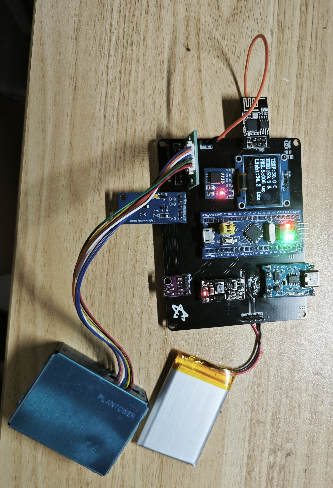
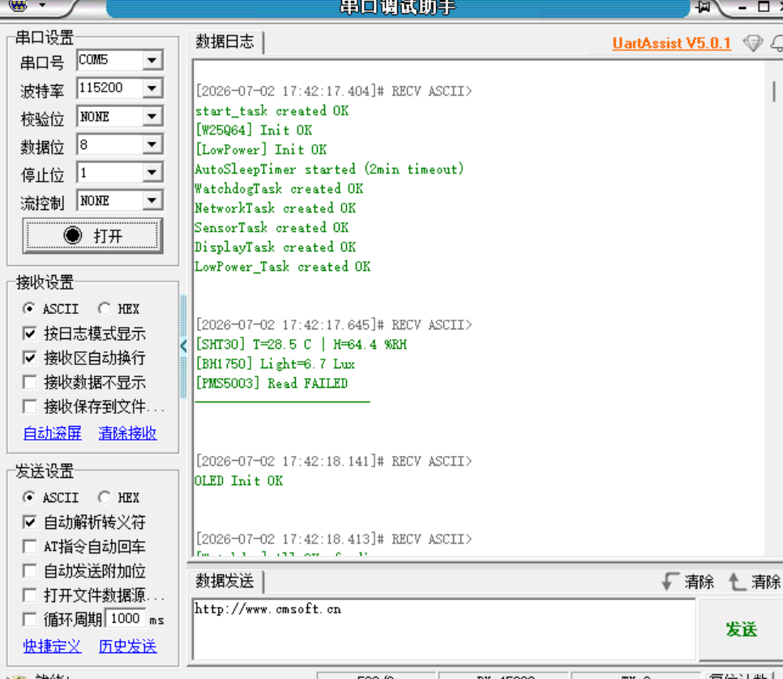
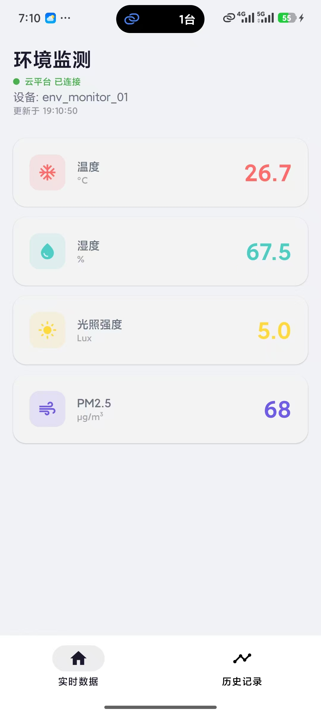
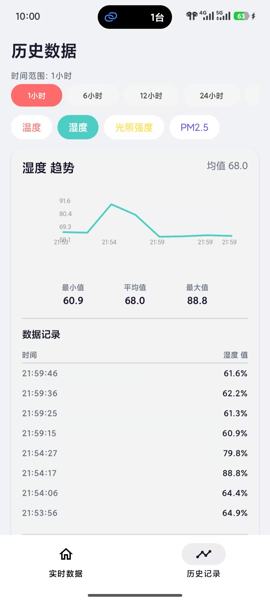

# 环境监测节点 / Environmental Monitoring Node

> **STM32F103C8T6 低功耗环境监测系统 | Low-power STM32-based Environmental Monitor**

> ### 📌 当前版本：**3.0**
> 电源架构重构 · **实测待机 300 µA** · 1200 mAh 电池纯待机约 **5.5 个月**
>
> 第一版代码归档在 [`v1.0-archive`](../../tree/v1.0-archive) 分支 ｜ 全部版本见 [Releases](../../releases)
>
> **3.0 主要改动**：MCU 改为电池直供并与升压链解耦 ｜ 新增电池电量检测与低压保护 ｜
> 完善睡前关断序列 ｜ App 支持回补 7 天历史数据 ｜ 详见下方 [版本说明](#-版本说明--versions)

---

## 🗂 版本说明 / Versions

| 版本 | 核心内容 | 位置 |
|---|---|---|
| **3.0**（当前） | 电源架构重构、待机 300 µA、电池电量检测与低压保护、PMS 主动复位、App 回补历史 | `master` 分支 ｜ `v3.0` 标签 |
| **1.0** | 首版：多传感器采集 + OneNet 上云 + Android 监控、STANDBY 双模式低功耗 | [`v1.0-archive`](../../tree/v1.0-archive) 分支 ｜ `v1.0` 标签 |

**从 1.0 到 3.0 的关键改动（为什么续航能差这么多）：**

| 维度 | 1.0 | **3.0** |
|---|---|---|
| **供电架构** | 电池 → 升压 5V → MCU 和所有外设都吃升压后的电 | **双轨**：`V3.3_A`（MCU 常开）+ `V3.3_SW`（受控外设） |
| **升压模块** | 一直工作，睡眠时关不掉 | **P-MOSFET 高边开关门控**，睡眠时整条链断电 |
| **待机电流** | 未实测（受升压模块静态电流制约） | **实测 300 µA** |
| **电池管理** | 无 | 分压 + ADC1_IN1 检测、OLED/云端/App 三端显示、<3.40V 低压关机 |
| **Flash** | W25Q64 | W25Q128（16 MB，代码兼容两种 ID） |
| **电池** | 603450 | 703048 / 1200 mAh |

---

## 📖 项目介绍 / Overview

本项目是一个基于 **STM32F103C8T6** 的便携式环境监测节点，集成多种传感器实时采集温度、湿度、光照强度、PM2.5 数据，通过 ESP8266 WiFi 模块上传至 **OneNet 云平台**，并配有 **Android App** 实时查看与历史数据分析，具有低功耗模式以及断网重传功能。

适用于：室内空气质量监测、智能家居传感器节点、嵌入式学习参考项目。

### 核心技术栈

| 层次 | 技术 |
|------|------|
| 微控制器 | STM32F103C8T6 (ARM Cortex-M3, 72MHz) |
| RTOS | FreeRTOS (多任务: 传感器/网络/显示/低功耗) |
| 通信 | USART1(调试) / USART2(ESP8266) / USART3(PMS5003) / I2C1(SHT30+BH1750) / SPI1(W25Q64/W25Q128) |
| 云平台 | OneNet MQTT |
| 移动端 | Android (Jetpack Compose + Room + HTTP API 轮询) |
| 供电 | 703048 锂电池 1200 mAh + TP4056 充电 + MT3608 升压 + ME6211×2 |
| 电池检测 | 电阻分压 → ADC1_IN1 (PA1)，OLED / 云平台 / App 三端显示电量 |
| 断网重传 | W25Q64/W25Q128 存储本地数据，断网时落盘，恢复网络后自动补传 |

---

## 🧩 硬件清单 / Hardware List

| 模块 | 型号 | 接口 | 功能 |
|------|------|------|------|
| 主控 | STM32F103C8T6 最小系统板 | — | 系统核心 |
| 温湿度 | SHT30 | I2C1 (PB6/PB7) | 温度±0.3°C, 湿度±2%RH |
| 光照 | BH1750 | I2C1 (PB6/PB7) | 光照强度 0~65535 Lux |
| PM2.5 | 攀藤 PMS5003 | USART3 (PB10/PB11) | 激光粉尘传感器 |
| 显示 | 0.96" OLED 128x64 | 软件I2C (PB8/PB9) | SSD1306驱动 |
| WiFi | ESP8266 ESP-01S | USART2 (PA2/PA3) | AT固件 2.2.2.0 |
| 存储 | W25Q64 / W25Q128 | SPI1 (PA4~PA7) | 离线数据存储（代码兼容两种 JEDEC ID） |
| 充电 | TP4056 模块 | — | 锂电池充电管理 |
| 升压 | MT3608 模块 | — | 3.7V → 5V（受 P-MOSFET 门控） |
| 电池 | **703048 / 1200 mAh** | — | 3.7V 锂聚合物 |
| 电池检测 | 电阻分压 R14/R15 | ADC1_IN1 (PA1) | 电量百分比（3.0 新增） |

### 引脚分配 / Pin Assignment

| STM32 引脚 | 连接设备 | 功能 |
|------------|---------|------|
| PA0 | 按键/唤醒 | EXTI 唤醒 |
| PA2 | ESP8266 RX | USART2_TX |
| PA3 | ESP8266 TX | USART2_RX |
| PA4 | W25Q64 CS | SPI1_NSS |
| PA5 | W25Q64 SCK | SPI1_SCK |
| PA6 | W25Q64 MISO | SPI1_MISO |
| PA7 | W25Q64 MOSI | SPI1_MOSI |
| PA9 | USB转TTL TX | USART1_TX (调试) |
| PA10 | USB转TTL RX | USART1_RX (调试) |
| PB1 | KEY1 | EXTI 按键 |
| PB2 | KEY2 | 普通按键 |
| PB6 | SHT30+BH1750 SCL | I2C1_SCL |
| PB7 | SHT30+BH1750 SDA | I2C1_SDA |
| PB8 | OLED SCL | 软件I2C |
| PB9 | OLED SDA | 软件I2C |
| PB10 | PMS5003 RX | USART3_TX |
| PB11 | PMS5003 TX | USART3_RX |
| PB12 | PMS5003 SET | GPIO 控制 |
| PC13 | LED | 状态指示 |

---

## 🔌 电路接线说明 / Wiring Guide

```

### 传感器接线 / Sensor Wiring

**I2C 总线 (PB6/PB7)** — SHT30 + BH1750 并联：
```
SHT30: VCC→3.3V GND→GND SCL→PB6 SDA→PB7
BH1750: VCC→3.3V GND→GND SCL→PB6 SDA→PB7
```

**OLED (PB8/PB9)** — 独立软件 I2C：
```
OLED: VCC→3.3V GND→GND SCL→PB8 SDA→PB9
```

---

## 💻 关键代码思路 / Code Architecture

### 系统任务 / FreeRTOS Tasks

```
freertos_demo.c
│
├── start_task       → 初始化互斥锁、W25Q、ADC、低功耗模块、创建子任务后自删除
├── SensorTask       → 每2秒采集一次：SHT30 → BH1750 → PMS5003 → 电池电压
├── NetworkTask      → 低压检查 → 初始化ESP8266 → 连接WiFi → MQTT → 上传（常亮10分钟/周期一次性）
├── DisplayTask      → 每秒更新OLED显示
└── LowPower_Task    → 接收休眠信号，执行关断序列后进入 STANDBY
```

### 传感器驱动 / Sensor Drivers

```
Int/
├── sht30.c      — I2C1读取温湿度 (IO模拟时序/无应答检查)
├── bh1750.c     — I2C1读取光照强度 (连续高分辨率模式)
├── pms5003.c    — USART3中断接收 (32字节帧解析+校验)
└── w25q64.c     — SPI1读写Flash (扇区擦除/页写入/离线存储)
```

### WiFi & 上云 / Cloud Connectivity

```
Int/
├── esp8266.c    — AT命令封装 (初始化/配网/TCP连接)
└── onenet_mqtt.c — OneNet MQTT协议 (CONNECT/PUBLISH/PINGREQ)
```

**WiFi 连接流程**：
```
ESP8266_Init() → 等待启动 → AT → ATE0 → AT+CWMODE=1
                      ↓
ESP8266_ConnectWiFi() → AT+CWJAP="SSID","PASS"
                      ↓
Onenet_Connect() → AT+CIPSTART → MQTT CONNECT → CONNACK
                      ↓
Onenet_Publish() → AT+CIPSEND → JSON数据 → PUBLISH ACK
```

### 云平台 / OneNet (OneNET Studio)

| 参数 | 值 |
|------|-----|
| 产品ID | `YOUR_PRODUCT_ID` |
| 设备名 | `YOUR_DEVICE_NAME` |
| Broker | `tcp://183.230.102.116:1883` |
| 数据上报 | 每10分钟 → JSON格式 |
| 认证 | Token鉴权 (HMAC-MD5) |

### Android App

```
AndroidApp/
├── data/mqtt/MqttManager.kt    — OneNet API轮询 (每10秒)
├── data/local/SensorDao.kt     — Room数据库 (历史数据)
├── ui/dashboard/               — 实时数据仪表盘 (Jetpack Compose)
└── ui/history/                 — 历史曲线 & 数据表格
```

**实时数据获取**：App 通过 OneNet Studio HTTP API (`iot-api.heclouds.com`) 定时查询设备最新数据，不占用 MQTT 设备连接。

### 低功耗设计 / Low Power

- 进入 STANDBY 模式，**实测整机待机电流 300 µA**（1200 mAh 电池约 5.5 个月）
- 睡前关断序列：OLED 关显示（`0xAE`+关电荷泵）→ BH1750 掉电 → Flash 深度掉电（`0xB9`）→ 关断升压链
- RTC 闹钟周期唤醒（周期模式 30 分钟 / 常亮模式 10 分钟上报一次）
- 唤醒后按复位标志区分「周期唤醒」与「手动开机」两种运行姿态

**功耗构成（300 µA 的拆解）：** LDO 静态 30 µA + 电池分压 21 µA + OLED 关屏 10 µA +
Flash 深度掉电 1 µA + MCU STANDBY 3 µA + PMS5003 残留电压漏电约 200 µA

---

## 📱 运行效果 / Screenshots

### 实物展示 / Hardware Photo



### 串口调试输出 / Serial Monitor



```
[SHT30] 温度: 25.7 ℃ | 湿度: 58.3 %RH
[BH1750] 光照强度: 6.7 Lux
[PMS5003] PM1.0: 12 ug/m3 | PM2.5: 17 ug/m3 | PM10: 17 ug/m3
[ESP8266] Init complete!
[WiFi] Connecting to YOUR_WIFI_SSID...
[WiFi] Connected! Got IP
[OneNet] MQTT连接成功
[OneNet] 上传成功: T=25.7 H=58.3 L=6.7 PM2.5=17
[AutoSleepTimer] 30秒无操作，准备进入休眠...
```

### Android App 界面 / App Screenshots

| 实时数据 / Dashboard | 历史数据 / History |
|:---:|:---:|
|  |  |

- **仪表盘**: 实时显示温度、湿度、光照强度、PM2.5
- **历史数据**: 趋势曲线图 + 统计值 (最小值/平均值/最大值)
- **数据记录**: 时间轴可滚动数据表格
- **时间筛选**: 1小时/6小时/12小时/24小时/7天/30天

---

## 🛠️ 开发环境 / Development Environment

| 工具 | 版本 |
|------|------|
| Keil MDK | V5.06 (ARMCC V5) |
| STM32CubeMX | HAL库 |
| FreeRTOS | CMSIS RTOS封装 |
| Android Studio | Kotlin + Jetpack Compose |
| 焊接工具 | T12焊台 (320°C ~ 350°C) |

## 📂 项目结构 / Project Structure

```
├── Core/                    HAL库配置 & 外设初始化 (CubeMX生成)
│   ├── Inc/                 gpio, i2c, spi, usart, rtc, adc 头文件
│   └── Src/                 gpio, i2c, spi, usart, rtc, adc, main, stm32f1xx_it
├── Int/                     项目核心代码
│   ├── freertos_demo.c      FreeRTOS任务创建 & 主逻辑
│   ├── sht30.c / bh1750.c   I2C传感器驱动
│   ├── pms5003.c            PM2.5传感器驱动 (USART3中断接收)
│   ├── esp8266.c / onenet_mqtt.c  WiFi & MQTT上云
│   ├── w25q64.c             SPI Flash存储 (离线数据缓存)
│   ├── low_power.c          低功耗模式管理
│   └── oled.c               0.96" OLED显示驱动 (软件I2C)
├── MDK-ARM/                 Keil MDK项目文件
├── AndroidApp/              Android端Jetpack Compose APP
└── README.md                本文件
```

---

## 🚀 快速开始 / Quick Start

1. **克隆仓库**
2. 用 **Keil MDK** 打开 `MDK-ARM/LEDFreeRTOS.uvprojx`
3. 修改 `esp8266.h` 中的 WiFi 配置 (`WIFI_SSID` / `WIFI_PASSWD`)
4. 编译下载至 STM32F103C8T6
5. 用 Android Studio 打开 `AndroidApp/`，编译安装到手机

---

## ⚠️ 注意事项 / Notes

- PMS5003 需要 **5V** 供电（通过 MT3608 升压模块从电池获取）
- ESP8266 RST 引脚必须接 **10K 上拉电阻到 3.3V**，不可悬空
- 传感器模块均为 3.3V 供电，与 STM32 电平兼容
- 默认上传间隔 **10 分钟**，可在 `freertos_demo.c` 中修改
- OneNet 平台 Token 需用官方工具生成或代码自动计算

---

## 📜 License

MIT License

---

*项目完整代码及文档仅供参考学习，如需商业使用请遵守相关开源协议。*
